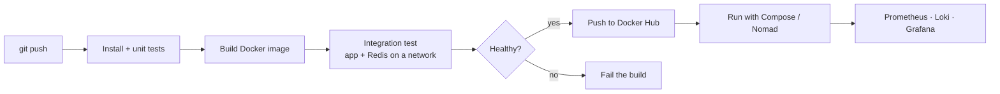

<!-- Profile README for github.com/atiqa-ai — place this file at the root of the repo atiqa-ai/atiqa-ai -->
 
<div align="center">

<a href="https://github.com/atiqa-ai"></a>
 
<br/>
[](https://www.linkedin.com/in/atiqa-mushtaq)
[](mailto:catiqa23@gmail.com)


 
</div>
> 💬 *I bridge Development, Operations and AI — and I wire up the monitoring that tells you whether any of it actually works.*
 
---
 
## 🔭 At a Glance
 
| | |
|---|---|
| **Role** | DevOps & MLOps Engineer in the making · 🎓 BS Computer Science Student |
| **Foundation** | Linux · Bash · Python · Git & GitHub Actions |
| **Focus** | CI/CD pipelines, Docker containerization, observability (Prometheus · Loki · Grafana) |
| **ML** | scikit-learn · Pandas · NumPy · PyTorch · Streamlit apps |
| **Now learning** | Terraform (IaC) · Kubernetes · automated model-retraining pipelines |
| **Philosophy** | A pipeline is only real if it *tests* the thing it ships |
| **Open to** | DevOps / MLOps / Cloud internships and junior roles |
 
---
 
## 📖 The Story So Far
 
Every project here started the same way: something worked on my machine, so I asked *"how do I prove it works anywhere — and keep proving it?"*
 
| Chapter | What happened |
|---|---|
| **01 · Scripts** | Started with **Bash on Linux** — automating user and permission management instead of clicking through it. |
| **02 · Python & ML** | Built classifiers and regressors (spam detection, MNIST, house prices) and learned that an honest metric beats a flattering one. |
| **03 · Tests & CI** | Gave every Python project a test suite and a GitHub Actions pipeline that runs on each push — up to **71 tests** in one repo. |
| **04 · Containers** | Packaged apps as Docker images, then wrote pipelines that boot the container and *test the running service* before publishing. |
| **05 · Observability** | Added health endpoints, Prometheus metrics, and Loki/Promtail log shipping so failures are visible, not guessed at. |
| **06 · What's next** | Infrastructure as Code with **Terraform**, orchestration with **Kubernetes**, and automated MLOps retraining. |
 
---
 
## 🚀 The Pipeline I Ship With
 

 
```bash
# my-working-rules
$ test every change        # pytest on every push
$ build once, run anywhere # Docker, multi-stage images
$ prove it's alive         # health + /metrics checks in CI
$ make it visible          # metrics, logs, dashboards
```
 
---
 
## ⭐ Featured Work
 
### 🛠️ DevOps, Containerization & Monitoring
 
<table>
<tr>
<td width="50%" valign="top">
#### 🐳 [Soul of Lahore — Containerization & Monitoring](https://github.com/atiqa-ai/soul-of-lahore-containerization-monitoring)
**Next.js 14 → production Docker image**
 
A cinematic Next.js 14 app shipped as a **three-stage, non-root Docker image** with a `/api/health` endpoint, Docker health checks, `restart: unless-stopped` auto-start, and a container-monitoring layer.
 
`Docker` `Docker Compose` `Next.js` `TypeScript` `Monitoring`
 
</td>
<td width="50%" valign="top">
#### 🧩 [DevOps Intern — Containerization, CI & Observability](https://github.com/atiqa-ai/devops-intern-final)
**Everything wired together**
 
Multi-stage Dockerfile, a GitHub Actions pipeline that boots the app and **asserts its Prometheus `/metrics` endpoint responds**, a **Nomad** job spec, and Loki/Promtail/Prometheus config.
 
`Docker` `GitHub Actions` `Prometheus` `Loki` `Promtail` `Nomad` `Bash`
 
</td>
</tr>
<tr>
<td colspan="2" valign="top">
#### 🔁 [CI/CD Pipelines and Dockerization](https://github.com/atiqa-ai/CI-CD-Pipelines-and-Dockerization)
**A working pipeline, not just a YAML file**
 
On every push it builds the image, then runs a genuine integration test — creates a network, starts **Redis and the application together**, `curl`s the running service, tears it all down — and only then **pushes the image to Docker Hub**.
 
`Docker` `Docker Compose` `GitHub Actions` `Redis` `Flask`
 
</td>
</tr>
</table>
### 🤖 Python & Machine Learning
 
> Each of these ships with a test suite and a CI pipeline that runs on every push.
 
| Project | What it does | Proof of quality | Stack |
|---|---|---|---|
| [**AI Speech Subtitles**](https://github.com/atiqa-ai/ai-speech-subtitles) | Turns a recorded lecture into **Urdu subtitles** — extracts audio, transcribes with Whisper, translates with GPT-4o-mini, writes SRT / WebVTT / dual-language files | **43 tests** + Docker image built in CI | Python · Whisper · OpenAI · Docker · pytest |
| [**Spam Classifier**](https://github.com/atiqa-ai/spam-classifier) | SMS spam classifier served through a Streamlit UI | **33 tests** incl. end-to-end app tests; container healthcheck runs in CI | scikit-learn · NLTK · Streamlit · Docker |
| [**Voice Assistant**](https://github.com/atiqa-ai/voice-assistant) | Opens sites, launches apps, tells the time, reads Wikipedia summaries aloud | Side effects made injectable → **71 tests**, no microphone needed | pyttsx3 · SpeechRecognition · PyAudio · pytest |
| [**Geolocation System**](https://github.com/atiqa-ai/geolocation-system) | Resolves public IP → city + coordinates → interactive Folium map | Handles network failures and API-level error payloads instead of assuming success | requests · Folium · argparse · pathlib |
| [**California Housing Regression**](https://github.com/atiqa-ai/california-housing-regression) | Linear-regression study with reproducible, committed outputs | Honest result: **R² ≈ 0.575** — the README explains why scaling and target clipping matter | scikit-learn · Pandas · NumPy · Jupyter |
 
<details>
<summary><b>🧪 More from the lab</b></summary>
<br/>
- 📚 [**ML-Projects**](https://github.com/atiqa-ai/ML-Projects) — Email spam classifier (TF-IDF + Naive Bayes / XGBoost / Random Forest, **up to 97% accuracy**, Streamlit app), MNIST digit classifier, SMS spam classifier with SVM, house-price prediction.
- 🐍 [**pyhton-projects**](https://github.com/atiqa-ai/pyhton-projects) — Python practice: record management, voice assistant, geolocation tools.
- 🐚 [**Bash-Scripting**](https://github.com/atiqa-ai/Bash-Scripting) — *User Automator*: Bash automation for Linux user and permission management.
</details>
---
 
## 🛠️ Tech Arsenal
 
<div align="center">
**Containers & CI/CD**
 

**Languages**
 

**Observability & Orchestration**
 

**AI / ML**
 

**Currently leveling up**
 

</div>
| Area | Tools |
|---|---|
| **Containers & CI/CD** | Docker · Docker Compose · GitHub Actions · Docker Hub · Redis · Flask |
| **Monitoring & Logs** | Prometheus · Grafana · Loki · Promtail · health endpoints · `/metrics` |
| **Orchestration & Networking** | Nomad · Linux · Networking |
| **Programming & Scripting** | Python · Bash · TypeScript · C++ |
| **AI / ML** | scikit-learn · Pandas · NumPy · PyTorch · NLTK · Whisper · Streamlit |
| **Testing** | pytest · integration tests in CI · container healthchecks |
 
---
 
## 🎯 Where I Fit
 
<table align="center">
<tr>
<td align="center" width="25%"><h3>⚙️ DevOps</h3>CI/CD pipelines that build, test, and publish Docker images automatically.</td>
<td align="center" width="25%"><h3>🧠 MLOps</h3>Tested, containerized ML apps — moving toward automated retraining.</td>
<td align="center" width="25%"><h3>🔭 Observability</h3>Health checks, Prometheus metrics, and Loki log shipping.</td>
<td align="center" width="25%"><h3>🐧 Linux & Automation</h3>Bash and Python scripts that replace repetitive manual work.</td>
</tr>
</table>
---
 
## 📚 Currently Sharpening
 
- 🏗️ **Infrastructure as Code — Terraform** *(the gap I know I have: no public IaC work yet, so this is in progress, not shipped)*
- ☸️ **Orchestration — Kubernetes**
- 🔄 **MLOps — automating model-retraining pipelines**
---
 
## 📊 GitHub Stats
 
<div align="center">


</div>
---
 
## 🤝 Let's Build Something Reliable
 
I'm looking for **DevOps, MLOps and Cloud** opportunities where I can ship, test, and observe real systems — and automate the parts that keep people up at night.
 
<div align="center">
[](https://www.linkedin.com/in/atiqa-mushtaq)
[](mailto:catiqa23@gmail.com)
 
*💭 "Learning never stops, and every project is a step forward."*
 

</div>
 
